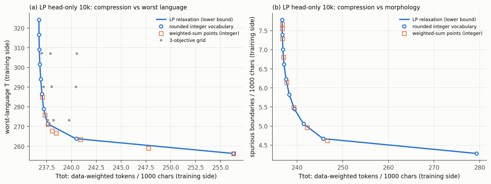
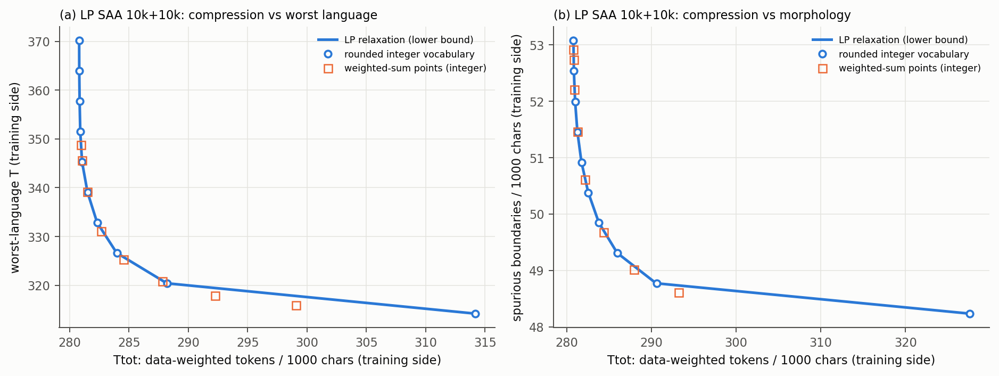
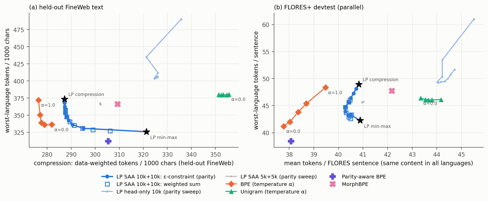
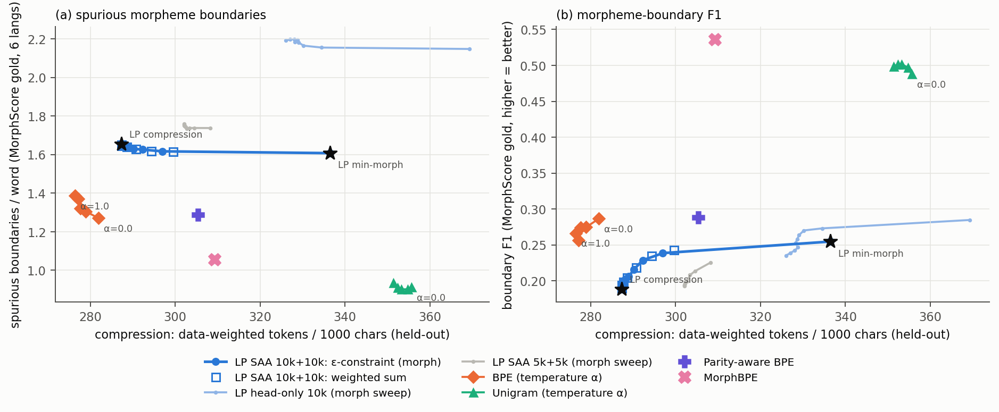
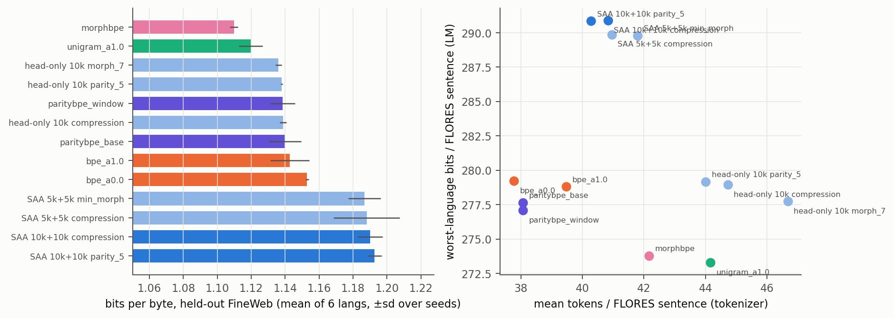
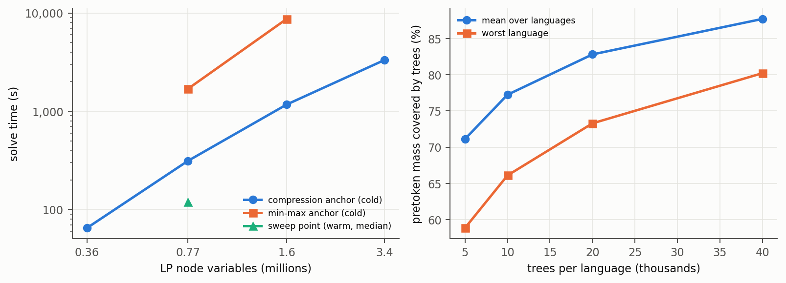

# Multi-objective vocabulary selection for multilingual tokenization

CS 769 (Optimization in Machine Learning) — final report.
Code and full logs: https://github.com/n6m9n/769 (tables of every number: `report/tables.md`).

## Abstract

We cast multilingual tokenizer vocabulary selection as a multi-objective linear program over split trees
(ToaST, Schmidt et al. 2026). Compression, worst-language cost (cross-lingual parity), spurious morpheme
boundaries and sharing are *aggregate columns*; every scalarisation (weighted sum, ε-constraint, min-max) only
changes costs or bounds of a few columns, so whole Pareto fronts are traced with warm-started simplex, reduced
costs are exchange rates between objectives, and LP-vs-rounded values certify every point. On 500 MB of
FineWeb / FineWeb-2 text in six typologically diverse languages (en, hi, mr, ta, ru, hu) we solve LPs with up to
3.4 M node variables, compare with BPE / Unigram under temperature sampling, Parity-aware BPE and MorphBPE, and
train 35 M-parameter language models per tokenizer.

**Findings.**
1. **The LP stays near-integral at scale.** Over 123 Pareto points of the three main runs, |gap| ≤ 3·10⁻⁴; with
   *bound shading* every rounded vocabulary satisfies its ε-bounds, so every gap is a certificate.
2. **Head-only fronts do not transfer.** The standard ToaST problem (trees for frequent pretokens only) gives
   very favourable training-side fronts (−21 % worst-language cost for +8 % total) that vanish on held-out text,
   where the LP loses clearly to BPE.
3. **A sample average approximation (SAA) of the pretoken tail fixes the objective** — after removing an
   optimizer's curse we diagnose (naive SAA underestimates the Russian cost by 24 %). Held-out hypervolume
   (compression × worst language) rises from 0.08 (head-only) to 0.75 (SAA), close to the BPE α-sweep (0.78).
4. **With the corrected objective the parity front transfers:** moving from the compression anchor to the min-max
   anchor lowers the worst-language held-out cost by 13 % (FineWeb) / 14 % (FLORES+) at an unchanged mean, gives
   the lowest cross-language Gini of any tokenizer (0.004), and a worst-language FineWeb cost below BPE at every
   temperature. Parity-aware BPE remains the fairest in absolute terms.
5. **Downstream LMs disagree with intrinsic metrics:** differences are ≤ 8 % bits per byte, the best LM uses
   MorphBPE, the most compressive tokenizer (BPE, uniform sampling) is the worst baseline, and the SAA LP
   tokenizers — better compressors than the head-only LP — give *worse* LMs.

---

## 1. Problem and formulation

Frequency-based tokenizers optimise compression greedily; the dominant language of the training mix wins,
non-Latin and low-resource languages pay a token premium, and splits ignore morphology. We make the competing
goals explicit objectives of one optimisation problem.

**Split trees.** Every frequent pretoken *j* gets a fixed full binary tree with character leaves; each internal
node splits where min(count(left), count(right)) is largest (language-balanced n-gram counts). Inference: walk
down and emit the first in-vocabulary node on each root-to-leaf path. Trees depend only on counts, never on the
vocabulary, so vocabulary selection is a linear problem.

**LP.** x_i ∈ [0,1]: token i is in the vocabulary (base characters fixed to 1); z_k ∈ [0,1]: node k is emitted.
Σ_i x_i = m − 256 (256 byte-fallback tokens reserved); Σ_{k on leaf→root path} z_k = 1 for every leaf;
z_k ≤ x_{tok(k)}.

**Aggregate columns** (each defined by one equality row, linear in z or x):

| column | meaning |
|---|---|
| T_l | tokens per 1000 English-equivalent characters of language l: 1000 κ_l / chars_l · Σ_k c_{j(k),l} z_k |
| M_l | spurious morpheme boundaries (nodes starting strictly inside a morpheme), same units |
| Ttot, Mtot | data-share weighted sums |
| t | worst-language cost, rows T_l − t ≤ 0 |
| S | cross-lingual sharing score Σ_i s_i x_i |

κ_l normalises content (characters of l per English character on FLORES+ dev: en 1.000, hi 1.001, mr 1.004,
ta 1.167, ru 1.103, hu 1.055). Morpheme boundaries come from unsupervised Morfessor models (training signal);
evaluation uses only gold MorphScore v2 (all six languages) and SIGMORPHON 2022 (en/ru/hu).

**Scalarisations = costs/bounds on aggregate columns.** Weighted sum: costs on Ttot, t, Mtot. ε-constraint: upper
bounds on t or Mtot. Min-max: cost on t. A bound change keeps the basis dual feasible (warm dual simplex), a cost
change keeps it primal feasible (warm primal simplex), and the reduced cost of a bounded column is dTtot/d(bound).

**Rounding and certificates.** Keep x ≈ 1, fill the remaining slots by LP contribution (weights from the duals of
the aggregate rows), then recompute all aggregates by exact split-tree inference. LP value = lower bound,
rounded value = upper bound.

## 2. Contributions of the final phase

1. **Bound shading.** Rounding used to overshoot ε-bounds (smoke run: 14/20 points), voiding the certificate. If the
   rounded vocabulary violates a bound, we tighten the bound by the overshoot, re-solve warm, and re-round (≤ 6×).
   The LP value at the original bound remains the lower bound. Bound violations: 0 of 123 points.
2. **Sample average approximation of the tail + candidate restriction** (§5).
3. **Parallel warm-started pipeline**: anchors solve cold in parallel and save HiGHS bases; each sweep runs in its
   own process warm from the compression basis; 3-objective grid with ε chosen per τ (no infeasible corners).
4. **Scaling**: exact level-wise (Apriori) n-gram counting, vectorised LP construction (2.6 M rows in 7 s),
   parallel counting and Morfessor training.
5. **Baselines**: Parity-aware BPE (authors' learner with our pretokenizer; FLORES+ dev as parity set), MorphBPE
   (reimplemented — no public code; merges never cross a Morfessor boundary).
6. **Evaluation**: gold morphology for all six languages, FLORES+ token premiums, and 35 M-parameter LMs (3 seeds).

## 3. Setup

- **Training text**: FineWeb sample-10BT (en) and FineWeb-2 (others), deliberately imbalanced — en 200 MB,
  hi 100, ru 75, hu 50, mr 50, ta 25 (393 M characters). Held-out: first 2000 documents per language.
- **Parallel evaluation**: FLORES+ devtest (1012 sentences, same content in every language).
- **Pretokenizer**: ToaST's length-limited GPT-4o regex (keeps Indic vowel signs attached), shared by all tokenizers.
- **Vocabulary size**: 32 000 for every tokenizer.
- **Compute**: 96-core / 1 TB server, 3× RTX A6000; HiGHS 1.16.

## 4. Head-only LP: favourable fronts that do not transfer

*Figure 1. Training-side fronts, head-only LP, 10k trees per language (54 k trees, 769 k nodes). Line: LP
relaxation (lower bound); circles: rounded vocabularies; squares: weighted-sum points.*

On the training side the parity front is very favourable: worst-language cost 324 → 271 (−16 %) for +0.4 % total
tokens, 256 (−21 %) at the min-max anchor (+8.3 %). All 44 points (anchors, parity, morph, 3×3 grid, two
weighted-sum sweeps) are near-integral (|gap| ≤ 3.0·10⁻⁴), and weighted-sum and ε-constraint points lie on the
same front.

**Held-out, these tokenizers lose to BPE and the fairness gain disappears:**

| tokenizer | FineWeb T mean / worst | FLORES tokens/sentence mean / worst |
|---|---|---|
| BPE α = 1 | 308.9 / 372.1 | 39.5 / 48.4 |
| BPE α = 0 | 296.8 / 336.3 | 37.8 / 41.2 |
| head-only LP, compression | 348.8 / 406.6 | 44.7 / 51.7 |
| head-only LP, best parity point | 343.3 / 404.4 | 44.0 / 49.4 |
| head-only LP, min-max | 354.3 / 490.3 | 45.5 / 61.0 |

Trees cover only 66–89 % of the pretoken mass (ru/hu 72 %): the LP never sees the long tail, spends the
vocabulary on whole frequent words, and buys fairness with whole words of the worst language that do not help
unseen text — the head-only min-max tokenizer is the *least* fair of them held out. More trees raise coverage only slowly
(5k → 40k trees/language: mean 71 % → 88 %, worst 59 % → 80 %) while solve time grows ≈ n^1.4 (§8).

## 5. Sample average approximation of the tail, and its optimizer's curse

For each language we add S trees for tail pretokens (pretokens without a head tree), drawn with probability
∝ count with replacement, each draw weighted by (tail mass)/S. For any *fixed* vocabulary the LP objective is then
an unbiased estimate of the token count over **all** text.

**The vocabulary is not fixed, though** — the LP chooses it with the same sample. If any frequent n-gram may be a
token, each sampled tail word carries the weight of a top-2000 word and the LP buys tokens that cover individual
sampled words. Measured on 5k head + 5k tail per language (LP estimate / exact cost on the full training
distribution, κ-normalised):

| candidate rule for tail trees | en | hi | mr | ta | ru | hu |
|---|---|---|---|---|---|---|
| any frequent n-gram | 232 / 269 | 290 / 302 | 293 / 312 | 379 / 396 | **290 / 381** | **289 / 353** |
| only tokens of head trees | 272 / 277 | 284 / 288 | 282 / 289 | 341 / 351 | 357 / 369 | 332 / 340 |

Restricting tail trees to candidate tokens that occur as nodes of head trees — tail trees *reweight* the objective
but never add candidates — removes the bias (estimate within 1–4 %), lowers the exact cost (ta 396 → 351,
hu 353 → 340) and makes the LP 3× faster (55 % of token variables fixed to 0). Sanity checks: the LP model and the
real tokenizer agree node for node (0 mismatches on 20 000 trees), and the exact training cost equals the held-out
cost (ru 381 vs 380), so the remaining error is purely the SAA estimate.

| tokenizer | FineWeb T mean / worst | FLORES mean / worst | hypervolume (FineWeb) |
|---|---|---|---|
| head-only 10k, compression | 348.8 / 406.6 | 44.7 / 51.7 | 0.082 (front) |
| SAA 5k+5k, n-gram rule | 335.8 / 393.6 | 43.0 / 51.2 | – |
| SAA 5k+5k, head rule, compression | 319.5 / 367.6 | 41.0 / 45.6 | 0.367 (front) |
| **SAA 10k+10k, compression** | **318.6 / 373.7** | **40.8 / 49.0** | **0.749 (front)** |
| SAA 20k+20k, compression | 319.1 / 381.8 | 40.9 / 49.9 | – |

SAA with half the trees cuts held-out tokens by 8 %; scaling the head beyond 10k gives nothing more.

## 6. Fronts under the corrected objective — and they transfer

*Figure 2. Training-side fronts, SAA 10k+10k (110 k trees, 1.7 M nodes, 2.6 M rows).*

*Figure 3. Held-out fronts. (a) FineWeb eval split: data-weighted tokens/1000 chars vs worst language.
(b) FLORES+ devtest: mean vs worst-language tokens per sentence (same content in all languages).*

**Training side (10k+10k):** worst-language cost 370 → 333 (−10 %) for +0.5 % Ttot, → 314 (−15 %) at the
min-max anchor (+12 %); spurious boundaries 53.1 → 48.6 (−8 %) for +4.4 % Ttot. 35 points, |gap| ≤ 2.1·10⁻⁴,
0 bound violations, monotone fronts; weighted sums and ε-constraints coincide.

**Held-out, the parity front now transfers** (unlike §4):

| tokenizer | FineWeb T mean / worst | Gini(T) | FLORES mean / worst | max premium |
|---|---|---|---|---|
| SAA LP, compression anchor | 318.6 / 373.7 | 0.069 | 40.8 / 49.0 | 1.56 |
| SAA LP, parity_5 (−10 % train) | 315.5 / 342.3 | 0.047 | 40.3 / 43.9 | 1.38 |
| SAA LP, min-max anchor | 321.4 / **325.9** | **0.004** | 40.9 / 42.3 | 1.06 |
| BPE α = 1 / α = 0 | 308.9 / 372.1 · 296.8 / 336.3 | 0.070 · 0.044 | 39.5 / 48.4 · 37.8 / 41.2 | 1.60 · 1.27 |
| Parity-aware BPE | 300.4 / **312.1** | 0.018 | 38.1 / **38.4** | **1.00** |
| MorphBPE | 328.0 / 366.3 | 0.048 | 42.2 / 47.7 | 1.31 |
| Unigram α = 1 | 349.2 / 379.9 | 0.030 | 44.2 / 46.1 | 1.05 |

The worst-language cost falls 13 % (FineWeb) / 14 % (FLORES) along the front while the mean stays flat — the
intermediate points even slightly *improve* the FLORES mean (40.8 → 40.3 tokens/sentence). The min-max tokenizer is the most even of all tokenizers (Gini 0.004) and has a
lower worst-language FineWeb cost than BPE at any temperature. Parity-aware BPE is still fairer in absolute
terms (it is tuned on FLORES+ dev, i.e. in-distribution for devtest, but also wins on FineWeb), and BPE with
uniform sampling has the best mean.

**Morphology.** 

*Figure 4. Held-out gold morphology (MorphScore v2, 6 languages).* Along the SAA morph sweep, gold boundary F1
rises 0.19 → 0.25 while compression degrades 17 %; MorphBPE (0.54) and Unigram (0.50) stay far ahead. The LP's
morph objective acts only within the split-tree candidate set, which cannot represent morpheme-shaped pieces
that the count-based trees do not offer.

**Hypervolume** (normalised to [ideal, 1.02 × nadir], higher = better):

| front | FineWeb compression × worst | FLORES mean × worst | compression × spurious |
|---|---|---|---|
| SAA LP 10k+10k (35 points) | 0.749 | 0.579 | 0.184 |
| SAA LP 5k+5k | 0.367 | 0.406 | 0.054 |
| head-only LP 10k | 0.082 | 0.135 | 0.000 |
| BPE α-sweep (5) | 0.783 | 0.831 | 0.588 |
| all 13 baselines | 0.925 | 0.995 | 0.757 |

## 7. Downstream language models

*Figure 5. Left: bits per byte on held-out FineWeb (mean of six languages, ± sd over 3 seeds). Right: tokenizer
FLORES tokens vs LM worst-language bits per FLORES sentence.*

35.5 M-parameter GPT (6 layers, d = 512, 8 heads, context 512, tied embeddings); the same 144 MB of text for every
tokenizer (24 MB per language, 4 epochs), same optimiser and tokens per step; bits per byte is
tokenization-independent.

| tokenizer | FineWeb bpb (± sd, 3 seeds) | FLORES bpb | worst-language bits / FLORES sentence | steps |
|---|---|---|---|---|
| MorphBPE | **1.110 ± 0.002** | **1.078** | 273.8 | 3283 |
| Unigram α = 1 | 1.120 ± 0.007 | 1.086 | **273.3** | 3572 |
| head-only LP 10k, morph_7 / parity_5 / compression | 1.136 / 1.138 / 1.139 (sd ≤ 0.002) | 1.110 – 1.112 | 277.7 – 279.2 | 3504 – 3674 |
| Parity-aware BPE | 1.140 ± 0.010 | 1.104 | 277.7 | 3106 |
| BPE α = 1 | 1.143 ± 0.012 | 1.104 | 278.8 | 3060 |
| BPE α = 0 | 1.153 ± 0.001 | 1.109 | 279.2 | 2989 |
| SAA LP 5k+5k, compression / min-morph | 1.188 ± 0.020 / 1.187 ± 0.010 | 1.151 / 1.149 | 289.9 / 289.8 | 3244 / 3309 |
| SAA LP 10k+10k, compression | 1.190 ± 0.007 | 1.152 | 290.9 | 3173 |
| SAA LP 10k+10k, parity_5 | 1.193 ± 0.004 | 1.154 | 290.9 | 3169 |

- **Intrinsic metrics do not predict LM quality.** BPE α = 0 has the best compression and is the worst baseline LM;
  morphology-aligned tokenizers (MorphBPE, Unigram) are best.
- **The SAA LP tokenizers compress better than the head-only LP but give worse LMs** (+4.5 % bpb), consistently over
  seeds and both SAA sizes; their per-token loss equals BPE's while their tokens carry fewer bytes. A plausible cause
  is word-dependent fragmentation (e.g. " an|i|ma|tion", " H|ar|va|rd"): split-tree inference cuts mid-frequency
  words into short pieces that depend on the word, which is harder to model.
- **Fairness of the tokenizer barely changes the fairness of the LM:** the SAA parity point cuts the worst-language
  FLORES token count by 10 % relative to the SAA compression anchor, yet its LM has the *same* worst-language bits per
  FLORES sentence (290.9 vs 290.9); across all tokenizers that quantity varies by only 2–6 %. The LM cost of a
  language is dominated by the language, not by its token premium.
- Noise floor: Parity-aware BPE's two variants produce identical tokenizations with permuted token ids and differ
  by up to 0.015 bpb. Caveat: with matched bytes, tokenizers that produce more tokens also get more steps.

## 8. Optimisation at scale

| trees/lang | trees | nodes | coverage mean / worst | compression anchor | min-max anchor | min-morph anchor |
|---|---|---|---|---|---|---|
| 5k | 27 k | 0.36 M | 71 % / 59 % | 65 s | – | – |
| 10k | 54 k | 0.77 M | 77 % / 66 % | 312 s | 1 690 s | 222 s |
| 20k | 109 k | 1.6 M | 83 % / 73 % | 1 171 s | 8 708 s | 819 s |
| 40k | 216 k | 3.4 M | 88 % / 80 % | 3 323 s | – | – |
| SAA 5k+5k (head rule) | 56 k | 0.83 M | – | 76 s | 437 s | 122 s |
| SAA 10k+10k (head rule) | 111 k | 1.7 M | – | 387 s | 2 524 s | 672 s |

- Compression anchors are exactly integral at every size. Dual simplex beat every alternative we tried on the 5k
  problem (dual 50 s, parallel dual 42 s, HiPO interior point 61 s, IPX 73 s, PDLP 87 s).
- Min-max anchors cost 5–7× a compression solve. Warm-starting them from the compression basis with primal simplex
  was inconclusive: at 10k+10k the warm solve had not finished after 23 min when the cold solve (42 min) completed.
- Warm sweep points cost a median 29 s (5k+5k), 119 s (10k) and 260 s (10k+10k), i.e. 10–40 % of a cold solve.
  After a simultaneous cost *and* bound change the warm dual simplex stalls; returning to the min-Ttot basis with a
  primal step first removed all cold fallbacks in the grid.

## 9. Ablation: morph-first trees

Choosing split positions at Morfessor boundaries first ([morph, grapheme, char], 10k trees/language) improves the
training side across the board: compression anchor Ttot 235.8 vs 236.7 with 4× fewer spurious boundaries
(2.0 vs 7.8), and the min-morph anchor reaches **zero spurious boundaries for +2.2 % Ttot**. Held-out, the tokenizer
needs Morfessor at inference for unseen words and compression collapses (FineWeb T mean 423 vs 349, FLORES worst
69 vs 52), while gold morphology improves only modestly (MorphScore F1 0.29 vs 0.24) — the same inference-cost
trade-off MUTANT reports.

## 10. Conclusions, limitations, next steps

- The multi-objective LP is a sound, certifiable optimiser for vocabulary selection; at our scale it stays
  near-integral and warm starts make fronts affordable.
- **What the LP optimises matters more than how well it optimises it.** Head-only objectives produce attractive
  but non-transferable fronts; an SAA objective with a candidate restriction against the optimizer's curse
  produces fronts that hold on unseen text.
- **The candidate set is now the bottleneck.** Within split-tree candidates the LP cannot match BPE's mean
  compression or Parity-aware BPE's fairness. Adding external candidates (BPE merges, Unigram pieces) as extra
  columns, or per-language tree budgets, is the natural next step.
- SAA uses a single sample; best practice would re-estimate the chosen vocabulary on an independent sample and
  report the statistical SAA gap.
- MorphBPE is a reimplementation; Indic gold morphology is small (MorphScore mr: 178 words). The LM study is small
  (35 M parameters, 25–30 M training tokens).

## References

Schmidt et al. 2026, *Tokenization with Split Trees* (arXiv 2605.22705) · Tempus et al. 2026, *Tokenisation via
Convex Relaxations* (arXiv 2605.22821) · Foroutan et al., *Parity-Aware BPE*, ACL 2026 · Asgari et al., *MorphBPE*,
Findings ACL 2026 · Rana et al., *MUTANT*, ACL 2026 · Arnett & Bergen 2025; Arnett et al. 2025 (MorphScore) ·
Penedo et al., FineWeb / FineWeb-2 · NLLB Team / OLDI, FLORES+ · Huangfu & Hall, HiGHS.
